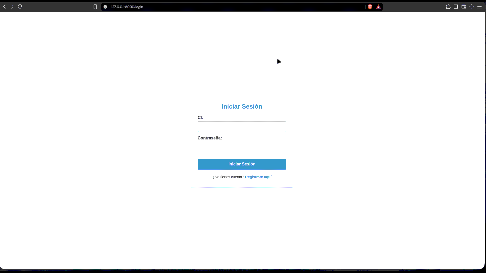
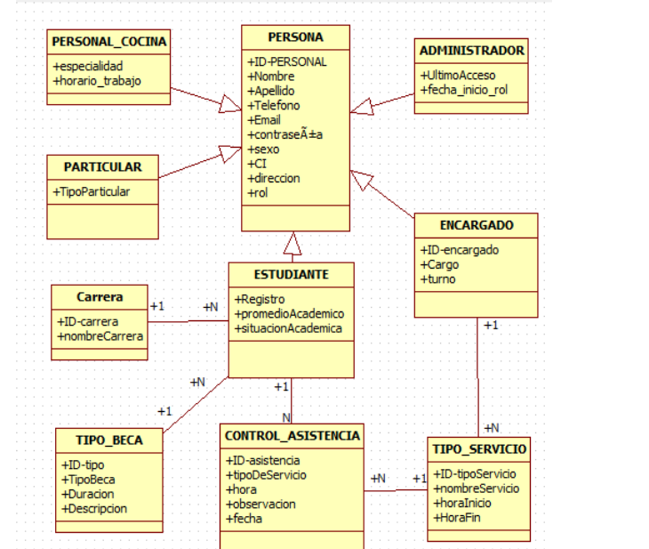

# BecaComedor — Sistema de Gestion del Comedor Universitario

Sistema web para la gestión del comedor universitario de la **U.A.G.R.M.**, desarrollado como proyecto de la materia **Sistemas de Información 1 (INF-342)**. Permite administrar la asistencia de estudiantes al comedor, gestionar tipos de beca, horarios de servicio, y controlar el acceso de personal administrativo, encargados y personal de cocina.

### Proyecto compilado


## Stack Tecnológico usado

| Capa | Tecnología |
|------|-----------|
| **Backend** | PHP 8.2+, Laravel 12.2 |
| **Frontend 1 (SPA)** | Vue 3 + TypeScript, Tailwind CSS 4, Inertia.js 2 |
| **Frontend 2 (Blade)** | Bootstrap 5.3, Font Awesome 6 |
| **Base de Datos** | PostgreSQL|
| **Autenticación** | Laravel Fortify + sistema de roles personalizado |
| **Build Tool** | Vite 7.x |
| **Dev Environment** | Laravel Sail (Docker) |


## Arquitectura General

El sistema tiene dos frentes:

1. **Blade + Bootstrap** — usado por los paneles de administracion, encargado, cocina y asistencia publica. Son vistas renderizadas del lado del servidor.

## Roles del Sistema

El sistema cuenta con **4 roles** con portales independientes:

### 1. ADMINISTRADOR
- **Login:** `/admin/login`
- **Dashboard:** `/admin/dashboard`
- **Permisos:** CRUD completo sobre 8 entidades:
  - Personas
  - Carreras
  - Estudiantes
  - Encargados
  - Personal de Cocina
  - Tipos de Beca
  - Particulares
  - Administradores
- Middleware: `AdminMiddleware` (verifica rol `ADMINISTRADOR`)

### 2. ENCARGADO (Supervisor)
- **Login:** `/encargado/login`
- **Dashboard:** `/encargado/dashboard`
- **Permisos:**
  - CRUD de Control de Asistencia (registro de comidas de estudiantes)
  - CRUD de Tipos de Servicio (configuración de horarios de comidas)
- Middleware: `CheckRole:ENCARGADO`

### 3. PERSONAL COCINA
- **Login:** `/cocina/login`
- **Vista:** `/cocina/horario` (solo lectura)
- **Permisos:** Visualizar su especialidad y horario asignado
- Middleware: `rol:PERSONAL_COCINA`

### 4. ESTUDIANTE (Asistencia Pública)
- **Acceso:** `/asistencia/registrar`
- **Flujo:** El estudiante ingresa su CI y contraseña, selecciona el tipo de servicio (almuerzo, cena, etc.), y el sistema registra su asistencia.
- **Restriccion:** No permite registrar mas de una asistencia por dia.
- No requiere sesion persistente (autoservicio).

--------------------------------------------------------------------------------

## Modelo de Datos (10 tablas)

### Tabla principal
- **personas** — Tabla de autenticación principal. Almacena nombre, apellido, CI (unico), contraseiaa, email, telefono, direccion, sexo y rol.

> **Nota:** Las contraseñas están en texto plano como medida temporal durante el desarrollo.

---

<h2 id="Configuracion2">tabla de base de datos relacional: </h2> 



---
<h2 id="Instalacion">Instalación Y Configuración local en diferentes Sistemas Operativos:</h2>

```bash
#dentro del proyecto (cd BecaComedor)
php --ini                                       #para buscar el php.ini descomenta la bd que usaras
composer install                                #instalar composer
#composer update --ignore-platform-reqs         #(si da error el composer install)
cp .env.example .env                            #crear el .env y configuralo
php artisan key:generate                        #genera la clave de aplicacion de Laravel
php artisan migrate                             #migrar las tablas a la bd  

php artisan serve                               #Iniciar el servidor
```

<h3  style="color: blue; font-size: 50px">Instalacion en Windows: </h3> 

```bash
# 1. Clonar el repositorio
git clone <repo-url>
cd BecaComedor
```
<h3>instalacion en Arch linux: </h3>

```bash
sudo pacman -S php                              #instalar php
sudo pacman -S composer                         #instalar composer
```

<h3> Instalacion en debian: </h3>

```bash
sudo apt install php php-cli php-mysql php-mbstring php-xml php-curl php-zip
sudo apt install composer                       #Instalar Composer
```

<h3> crea usuario admin en tu BASE DE DATOS :  </h3>

```bash
INSERT INTO personas (nombre, apellido, contrasena, sexo, ci, rol)
VALUES ('nombre', 'apellido', 'MiClave1234', 'M', '12345678', 'ADMINISTRADOR');
```